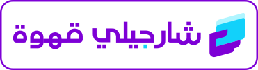
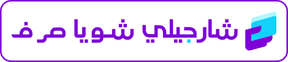

<div dir="rtl" align="center">

# شارجيلي — أزرار دعم لمشاريعك مفتوحة المصدر ☕

**أزرار جاهزة بأسلوب «Buy Me a Coffee» وبهوية شارجيلي الجزائرية — بعبارتين بالعربية والدارجة**


<br><br>


[](LICENSE)
[](assets)
[](NOTICE.md)

</div>

<div dir="rtl">

## ما هذا المشروع؟

كثير من المطورين العرب يضعون في ملفات `README.md` زر **Buy Me a Coffee**، لكنه يرسلك إلى منصة أجنبية لا تناسب كل من يريد استقبال الدعم من الجزائر.
هذا المستودع يقدّم **أزراراً جاهزة بالعربية** تضعها في مستودعك أو موقعك، وتوجّهها إلى **رابط الدفع الخاص بك في [شارجيلي](https://github.com/Chargily)** — البوابة الجزائرية التي تدعم الدفع بـ **الذهبية (EDAHABIA)** و**CIB**.

الاسم نفسه فيه لعبة بالدارجة الجزائرية: «شارجيلي» تعني «اشحن لي». لذلك تُقرأ الجملة كأنك تطلب:

- **«شارجيلي قهوة»** ☕ — «اشحن لي قهوة».
- **«شارجيلي شويا صرف»** — «اشحن لي شويّة صرف»، و«الصرف» بالدارجة هو المال أو الفكّة.

## العبارات والنسخ

لكل عبارة نسختان: **بنفسجية** (مملوءة، الأنسب لأي صفحة) و**فاتحة** (خلفية بيضاء بإطار بنفسجي).

| العبارة | النسخة | المعاينة | الملفات | الأبعاد الافتراضية |
|---|---|---|---|---|
| **شارجيلي قهوة** | بنفسجية |  | [`svg`](assets/svg/chargily-coffee-purple.svg) · [`png`](assets/png/chargily-coffee-purple.png) | 371 × 103 |
| | فاتحة |  | [`svg`](assets/svg/chargily-coffee-light.svg) · [`png`](assets/png/chargily-coffee-light.png) | 371 × 103 |
| **شارجيلي شويا صرف** | بنفسجية |  | [`svg`](assets/svg/chargily-sarf-purple.svg) · [`png`](assets/png/chargily-sarf-purple.png) | 470 × 103 |
| | فاتحة |  | [`svg`](assets/svg/chargily-sarf-light.svg) · [`png`](assets/png/chargily-sarf-light.png) | 470 × 103 |

ملفات PNG بعرض 1200px. كل زر له خلفيته الخاصة، فيظهر بشكل سليم في الوضعين الفاتح والداكن على GitHub.

## الاستخدام السريع

1. انسخ ملف الزر الذي تريده من مجلد [`assets/svg`](assets/svg) إلى مستودعك (مثلاً `assets/support-button.svg`).
2. أنشئ **رابط دفع** من لوحة حسابك في شارجيلي (راجع توثيقهم الرسمي للخطوات الحالية).
3. ضع هذا السطر في `README.md`:

```markdown
<a href="رابط_الدفع_الخاص_بك">
  
</a>
```

عبارة «شويا صرف» أطول، فاجعل عرضها بين `300` و`380` ليبقى ارتفاع الزر مماثلاً لزر «قهوة». للمزيد من الصيغ (HTML، ملف GitHub الشخصي، `FUNDING.yml`، نسخة PNG) انظر **[docs/USAGE.md](docs/USAGE.md)**.

## بنية المستودع

```text
chargily-coffee-button/
├── assets/
│   ├── svg/            ← الأزرار النهائية (متجهية، الأفضل للاستخدام): 4 ملفات
│   └── png/            ← نفس الأزرار بصيغة PNG بعرض 1200px: 4 ملفات
├── brand/              ← ملفات الشعار الأصلية المستخدمة كمصدر
├── src/
│   └── build_button.py ← المولّد: يرسم «قهوة» و«شويا صرف» برمجياً
├── docs/
│   ├── USAGE.md        ← طرق الاستخدام بالتفصيل
│   └── DESIGN.md       ← كيف صُمّمت الحروف وقياسات الخط
├── examples/
│   └── index.html      ← صفحة معاينة محلية للأزرار الأربعة
├── NOTICE.md           ← تنبيه العلامة التجارية
├── CONTRIBUTING.md · CHANGELOG.md · LICENSE · requirements.txt
```

## إعادة توليد الأزرار

الكلمات الإضافية ليست صوراً جاهزة، بل **مرسومة بالكود** بنفس هندسة خط «شارجيلي»: سماكة واحدة، خط أساس واحد، نقاط مربعة، وزوايا بأنصاف أقطار ثابتة. حرف «ش» في «شويا» مقصوص من الشعار الأصلي نفسه، وبقية الحروف مرسومة.

```bash
pip install -r requirements.txt       # cairosvg لتوليد PNG (اختياري)
python3 src/build_button.py           # كل العبارات
python3 src/build_button.py sarf      # عبارة واحدة: coffee أو sarf
```

تفاصيل القياسات وقصة تصميم كل حرف في **[docs/DESIGN.md](docs/DESIGN.md)**.

## تنبيه مهم عن الشعار والعلامة التجارية

- هذا مشروع **غير رسمي**، ولا علاقة له بشركة شارجيلي ولا يحمل تأييدها.
- اسم «Chargily / شارجيلي» وشعارها **ملك لأصحابها**. حروف «قهوة» و«صرف» وغيرها من الحروف المرسومة هنا تقليد لأسلوب الخط وليست خط الشركة الأصلي، أما «ش» في «شويا» فمقصوصة من ملف شعارها.
- الكود المرخّص بـ MIT هو المولّد والوثائق فقط. اقرأ **[NOTICE.md](NOTICE.md)** قبل استخدام الشعار في مشروع تجاري أو نشره على نطاق واسع.

## المساهمة

الأفكار والتحسينات مرحّب بها: عبارات جديدة، نسخة إنجليزية، ألوان إضافية، تحسين شكل حرف. اقرأ [CONTRIBUTING.md](CONTRIBUTING.md) ثم افتح Issue أو Pull Request.

## الكلمات المفتاحية

زر دعم · زر تبرع · شارجيلي · شارجيلي قهوة · شارجيلي شويا صرف · الذهبية · CIB · الجزائر · دارجة جزائرية · دفع إلكتروني جزائري · بديل Buy Me a Coffee · README badge · خط عربي هندسي · SVG

</div>

---

<div align="left" dir="ltr">

## English summary

**chargily-coffee-button** is an unofficial, ready-to-use set of **donation / "support me" buttons for README files and websites**, in the style of *Buy Me a Coffee* but with Arabic (Algerian-dialect) wording that plays on the name **Chargily** ("charge-li", i.e. "top up for me"):

- **«شارجيلي قهوة»** — "Chargily, a coffee".
- **«شارجيلي شويا صرف»** — "Chargily, a bit of change/money".

Each phrase comes in two variants (filled purple / light), as **SVG and PNG**. The buttons are meant to link to your own payment link on **[Chargily](https://github.com/Chargily)**, the Algerian payment gateway that supports **EDAHABIA** and **CIB** cards.

The extra Arabic words are **generated in code** to match the geometric lettering of the Chargily wordmark (`src/build_button.py`); the letter ش in «شويا» is cut from the wordmark itself. Code: MIT. Chargily's name and logo belong to their owners — see [NOTICE.md](NOTICE.md).

```markdown
[](YOUR_CHARGILY_PAYMENT_LINK)
[](YOUR_CHARGILY_PAYMENT_LINK)
```

</div>
