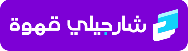

<div dir="rtl" align="center">

# شارجيلي قهوة ☕

**زر دعم جاهز لمشاريعك مفتوحة المصدر — بأسلوب «Buy Me a Coffee» وبهوية شارجيلي الجزائرية**



[](LICENSE)
[](assets)
[](NOTICE.md)

</div>

<div dir="rtl">

## ما هذا المشروع؟

كثير من المطورين العرب يضعون في ملفات `README.md` زر **Buy Me a Coffee**، لكنه يرسلك إلى منصة أجنبية لا تناسب كل من يريد استقبال الدعم من الجزائر.
هذا المستودع يقدّم **زراً جاهزاً بالعربية** تضعه في مستودعك أو موقعك، وتوجّهه إلى **رابط الدفع الخاص بك في [شارجيلي](https://github.com/Chargily)** — البوابة الجزائرية التي تدعم الدفع بـ **الذهبية (EDAHABIA)** و**CIB**.

الاسم نفسه فيه لعبة بالدارجة الجزائرية: «شارجيلي» تعني «اشحن لي»، فتُقرأ الجملة كأنك تطلب: **«شارجيلي قهوة»** ☕

## النسخ المتوفرة

| النسخة | المعاينة | الملفات |
|---|---|---|
| **بنفسجية** (مملوءة) — الأنسب لأي صفحة |  | [`svg`](assets/svg/chargily-coffee-purple.svg) · [`png`](assets/png/chargily-coffee-purple.png) |
| **فاتحة** (خلفية بيضاء بإطار بنفسجي) |  | [`svg`](assets/svg/chargily-coffee-light.svg) · [`png`](assets/png/chargily-coffee-light.png) |

الزر له خلفيته الخاصة، فيظهر بشكل سليم في الوضعين الفاتح والداكن على GitHub.

## الاستخدام السريع

1. انسخ ملف الزر الذي تريده من مجلد [`assets/svg`](assets/svg) إلى مستودعك (مثلاً `assets/support-button.svg`).
2. أنشئ **رابط دفع** من لوحة حسابك في شارجيلي (راجع توثيقهم الرسمي للخطوات الحالية).
3. ضع هذا السطر في `README.md`:

```markdown
<a href="رابط_الدفع_الخاص_بك">
  
</a>
```

للمزيد من الصيغ (HTML، ملف GitHub الشخصي، `FUNDING.yml`، نسخة PNG) انظر **[docs/USAGE.md](docs/USAGE.md)**.

## بنية المستودع

```text
chargily-coffee-button/
├── assets/
│   ├── svg/            ← الأزرار النهائية (متجهية، الأفضل للاستخدام)
│   └── png/            ← نفس الأزرار بصيغة PNG بعرض 1200px
├── brand/              ← ملفات الشعار الأصلية المستخدمة كمصدر
├── src/
│   └── build_button.py ← مولّد الزر (يرسم كلمة «قهوة» برمجياً)
├── docs/
│   ├── USAGE.md        ← طرق الاستخدام بالتفصيل
│   └── DESIGN.md       ← كيف صُمّمت الحروف وقياسات الخط
├── examples/
│   └── index.html      ← صفحة معاينة محلية
├── NOTICE.md           ← تنبيه العلامة التجارية
├── CONTRIBUTING.md · CHANGELOG.md · LICENSE · requirements.txt
```

## إعادة توليد الأزرار

كلمة «قهوة» ليست صورة جاهزة، بل **مرسومة بالكود** بنفس هندسة خط «شارجيلي»: سماكة واحدة، خط أساس واحد، نقاط مربعة، وزوايا بأنصاف أقطار ثابتة.

```bash
pip install -r requirements.txt   # cairosvg لتوليد PNG (اختياري)
python3 src/build_button.py
```

ينتج عن ذلك ملفات `assets/svg` و`assets/png` من جديد. تفاصيل القياسات وقصة تصميم كل حرف في **[docs/DESIGN.md](docs/DESIGN.md)**.

## تنبيه مهم عن الشعار والعلامة التجارية

- هذا مشروع **غير رسمي**، ولا علاقة له بشركة شارجيلي ولا يحمل تأييدها.
- اسم «Chargily / شارجيلي» وشعارها **ملك لأصحابها**. حروف «قهوة» تقليد لأسلوب الخط وليست خط الشركة الأصلي.
- الكود المرخّص بـ MIT هو مولّد الزر فقط. اقرأ **[NOTICE.md](NOTICE.md)** قبل استخدام الشعار في مشروع تجاري أو نشره على نطاق واسع.

## المساهمة

الأفكار والتحسينات مرحّب بها: نسخة إنجليزية، ألوان إضافية، تحسين شكل حرف. اقرأ [CONTRIBUTING.md](CONTRIBUTING.md) ثم افتح Issue أو Pull Request.

## الكلمات المفتاحية

زر دعم · زر تبرع · شارجيلي · الذهبية · CIB · الجزائر · دفع إلكتروني جزائري · بديل Buy Me a Coffee · README badge · خط عربي هندسي · SVG

</div>

---

<div align="left" dir="ltr">

## English summary

**chargily-coffee-button** is an unofficial, ready-to-use **donation / "support me" button for README files and websites**, designed in the style of *Buy Me a Coffee* but with the Arabic wording **«شارجيلي قهوة»** ("Chargily, a coffee"). It is meant to link to your own payment link on **[Chargily](https://github.com/Chargily)**, the Algerian payment gateway that supports **EDAHABIA** and **CIB** cards.

- Two variants (filled purple / light), each as **SVG and PNG**.
- The Arabic word *قهوة* is **generated in code** to match the geometric lettering of the Chargily wordmark (`src/build_button.py`).
- Code: MIT. Chargily's name and logo belong to their owners — see [NOTICE.md](NOTICE.md).

```markdown
[](YOUR_CHARGILY_PAYMENT_LINK)
```

</div>
