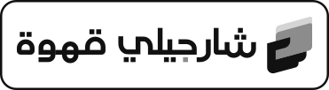
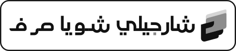
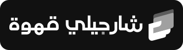
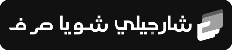

<div dir="rtl">

# تخصيص الألوان

يمكنك تغيير ألوان أي زر إلى ما تشاء، سواء ليتناسب مع هوية مشروعك أو مع خلفية صفحتك. التخصيص متاح للعبارتين («قهوة» و«شويا صرف») بنفس الطريقة.

## 1) الخانات اللونية الست

الأسماء مأخوذة من أسلوب زر **Buy Me a Coffee** (`button_colour` و`font_colour` و`outline_colour`…)، وقيمها **HEX بدون `#`** مثل `7D00D6`.

| المعامل | ما الذي يلوّنه | الراية في سطر الأوامر |
|---|---|---|
| `button_colour` | خلفية الزر (يقبل `transparent`) | `--button-colour` |
| `outline_colour` | الإطار المحيط بالزر (يقبل `transparent`) | `--outline-colour` |
| `font_colour` | كل الحروف وكل النقاط المربعة | `--font-colour` |
| `logo_colour` | الوجه الأمامي الكبير في علامة شارجيلي | `--logo-colour` |
| `accent_colour` | الطبقة الوسطى للعلامة + نقطة الجيم في «شارجيلي» | `--accent-colour` |
| `accent_light_colour` | الطبقة الخلفية الفاتحة للعلامة | `--accent-light-colour` |

تُقبل صيغ `FFF` و`FFFFFF` و`#FFFFFF`. وتُقبل `none` أو `transparent` للخلفية والإطار فقط.

## 2) الإعدادات الجاهزة

| الاسم | الوصف | button | outline | font | logo | accent | accent_light |
|---|---|---|---|---|---|---|---|
| `purple` | الأصل: بنفسجي مملوء | `7D00D6` | `7D00D6` | `FFFFFF` | `FFFFFF` | `12D1FA` | `B0F5FF` |
| `light` | الأصل: أبيض بإطار بنفسجي | `FFFFFF` | `7D00D6` | `7D00D6` | `7D00D6` | `12D1FA` | `B0F5FF` |
| `mono` | **أبيض وأسود وتدرج رمادي** | `FFFFFF` | `111111` | `111111` | `111111` | `8C8C8C` | `D4D4D4` |
| `mono-dark` | عكس السابق على خلفية سوداء | `111111` | `111111` | `FFFFFF` | `FFFFFF` | `A0A0A0` | `5C5C5C` |

في `mono` تتدرج طبقات العلامة من الأسود (الأمامية) إلى رمادي متوسط ثم رمادي فاتح (الخلفية)، وفي `mono-dark` ينعكس التدرج: الأبيض أمامياً، ثم رمادي، ثم رمادي داكن في الخلف.

<table>
<tr>
<td align="center"></td>
<td align="center"></td>
</tr>
<tr>
<td align="center"></td>
<td align="center"></td>
</tr>
</table>

ملفاتها جاهزة في `assets/svg` و`assets/png` بالأسماء `chargily-coffee-mono` و`chargily-sarf-mono` و`chargily-coffee-mono-dark` و`chargily-sarf-mono-dark`.

## 3) الطريقة الأولى: صفحة المُخصِّص (الأسهل)

افتح [`builder/index.html`](../builder/index.html) في المتصفح (ملف واحد يعمل بدون إنترنت). فيها:

- اختيار العبارة، وإعدادات جاهزة بنقرة، وست خانات لونية (منتقي ألوان + حقل HEX).
- معاينة فورية على خلفية فاتحة أو داكنة أو مخططة (لاختبار الشفاف).
- تحذير تلقائي إذا كان التباين بين الحروف والخلفية أقل من 3:1.
- أزرار: **نسخ SVG**، **تنزيل SVG**، **تنزيل PNG**، **نسخ سطر Markdown**، **نسخ رابط هذا الإعداد**.

رابط الإعداد يحمل ألوانك في عنوان الصفحة بنفس أسماء المعاملات، فتستطيع مشاركته أو حفظه:

```text
builder/index.html?phrase=sarf&button_colour=000000&outline_colour=000000&font_colour=FFFFFF&logo_colour=FFFFFF&accent_colour=A0A0A0&accent_light_colour=5C5C5C
```

المعاملات: `phrase` (`coffee` أو `sarf`) و`preset` (اختياري، أساس الألوان غير المذكورة) ثم المعاملات الستة. الخانة غير المذكورة تأخذ قيمتها من الإعداد الجاهز (الافتراضي `purple`).

لاستخدام الصفحة على الإنترنت فعّل **GitHub Pages** من إعدادات المستودع، فتصبح متاحة على `https://اسمك.github.io/اسم_المستودع/builder/`.

## 4) الطريقة الثانية: سطر الأوامر

```bash
# ألوان مخصصة → out/chargily-coffee-green.svg و.png
python3 src/build_button.py coffee \
  --button-colour 0B3D2E --outline-colour 0B3D2E --font-colour FFFFFF \
  --logo-colour FFFFFF --accent-colour 7CFFB2 --accent-light-colour 1F6F54 \
  --name green

# تعديل لون واحد فقط على أساس إعداد جاهز
python3 src/build_button.py sarf --preset mono --accent-colour 999999 --name my-gray

# خلفية شفافة
python3 src/build_button.py coffee --preset light --button-colour none --name transparent

# إعداد جاهز واحد إلى assets/
python3 src/build_button.py sarf --preset mono

# عرض الإعدادات الجاهزة
python3 src/build_button.py --list-presets
```

خيارات إضافية: `--out مجلد` (الافتراضي `out/`)، و`--width 1600` لعرض PNG، و`--no-png` لتوليد SVG فقط. تُقبل أيضاً الكتابة الأمريكية `--button-color`. عند إدخال لون خاطئ يتوقف المولّد برسالة واضحة، وعند ضعف التباين يطبع تحذيراً دون أن يمنع التوليد.

## 5) نصائح

- **التباين:** اجعل لون الحروف والوجه الأمامي للشعار مختلفاً جداً عن الخلفية (3:1 على الأقل).
- **الشفاف:** إن جعلت الخلفية شفافة فاختر لوناً للحروف يظهر على صفحتك الفاتحة والداكنة معاً، أو أعدّ نسختين.
- **تدرج العلامة:** اجعل `accent_light_colour` أقرب لخلفية الزر من `accent_colour` ليظهر العمق (الطبقة الخلفية أبهت).
- **الهوية البصرية:** لا تغيّر شكل العلامة نفسه (الأشكال هي هي)، والتخصيص للألوان فقط.

## 6) لماذا لا يوجد رابط صورة حيّ مثل Buy Me a Coffee؟

زر Buy Me a Coffee يولّد صورته من خادم يقرأ الألوان من الرابط. هذا المستودع ملفات ثابتة بلا خادم، فبدلاً من رابط حيّ تولّد ملف SVG بألوانك (من الصفحة أو سطر الأوامر) وتضعه في مستودعك. الناتج ملف مستقل لا يعتمد على موقع خارجي.

## 7) كيف يعمل داخلياً

`src/build_button.py` يبني الهندسة مرة واحدة كقالب فيه علامات لونية (`@@FONT@@` وأخواتها)، ثم يستبدلها بالألوان المطلوبة. الصفحة `builder/index.html` تُولَّد من نفس القوالب، فمخرجاتها **مطابقة بايتاً ببايت** لملفات المولّد. لا تعدّل `builder/index.html` يدوياً؛ عدّل `src/builder_template.html` ثم شغّل `python3 src/build_button.py`.

</div>
